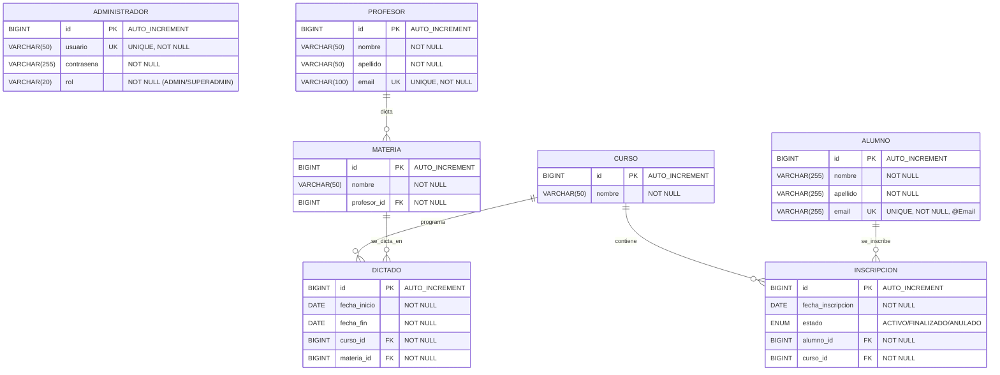

# 📊 DIAGRAMA DE BASE DE DATOS - SISTEMA DE GESTIÓN ESCOLAR

## 🗄️ **ESTRUCTURA COMPLETA DE LA BASE DE DATOS**



---

## 🏗️ **ARQUITECTURA DE DATOS**

### 📋 **ENTIDADES PRINCIPALES**

#### 🧑‍💼 **ADMINISTRADOR**
- **Tabla:** `administrador`
- **Herencia:** `BaseEntity` 
- **Propósito:** Gestión de usuarios administrativos del sistema
- **Campos clave:**
  - `usuario`: Login único del administrador
  - `contrasena`: Credencial encriptada
  - `rol`: Nivel de permisos (ADMIN/SUPERADMIN)

#### 👨‍🎓 **ALUMNO**
- **Tabla:** `alumnos`
- **Herencia:** Ninguna (entidad independiente)
- **Propósito:** Registro de estudiantes
- **Campos clave:**
  - `email`: Contacto único del alumno
  - `nombre/apellido`: Identificación personal

#### 👨‍🏫 **PROFESOR**
- **Tabla:** `profesor`
- **Herencia:** `BaseEntity`
- **Propósito:** Docentes que imparten materias
- **Relaciones:** `1:N` con Materia

#### 📚 **MATERIA**
- **Tabla:** `materia`
- **Herencia:** `BaseEntity`
- **Propósito:** Asignaturas del plan de estudios
- **Relaciones:** 
  - `N:1` con Profesor (cada materia tiene UN profesor)
  - `1:N` con Dictado (una materia puede dictarse en varios cursos)

#### 🎓 **CURSO**
- **Tabla:** `curso`
- **Herencia:** `BaseEntity`
- **Propósito:** Cohortes o grupos de estudiantes
- **Relaciones:**
  - `1:N` con Inscripción (un curso tiene muchos alumnos)
  - `1:N` con Dictado (un curso tiene muchas materias)

#### 📝 **INSCRIPCIÓN**
- **Tabla:** `inscripcion`
- **Herencia:** `BaseEntity`
- **Propósito:** Relación Alumno-Curso con estado
- **Campos clave:**
  - `fecha_inscripcion`: Cuándo se inscribió
  - `estado`: ACTIVO/FINALIZADO/ANULADO
- **Relaciones:** 
  - `N:1` con Alumno
  - `N:1` con Curso

#### 📅 **DICTADO**
- **Tabla:** `dictado`
- **Herencia:** `BaseEntity`
- **Propósito:** Programación de materias en cursos específicos
- **Campos clave:**
  - `fecha_inicio/fecha_fin`: Período de dictado
- **Relaciones:**
  - `N:1` con Curso (qué curso)
  - `N:1` con Materia (qué materia)

---

## 🔗 **ANÁLISIS DE RELACIONES**

### 📊 **CARDINALIDADES**

| Relación | Tipo | Descripción |
|----------|------|-------------|
| **Profesor → Materia** | `1:N` | Un profesor dicta varias materias |
| **Curso → Inscripción** | `1:N` | Un curso tiene muchos alumnos inscritos |
| **Alumno → Inscripción** | `1:N` | Un alumno puede inscribirse a varios cursos |
| **Curso → Dictado** | `1:N` | Un curso programa varias materias |
| **Materia → Dictado** | `1:N` | Una materia se dicta en varios cursos |

### 🔑 **CLAVES FORÁNEAS**

```sql
-- MATERIA
FOREIGN KEY (profesor_id) REFERENCES profesor(id)

-- INSCRIPCION  
FOREIGN KEY (alumno_id) REFERENCES alumnos(id)
FOREIGN KEY (curso_id) REFERENCES curso(id)

-- DICTADO
FOREIGN KEY (curso_id) REFERENCES curso(id)
FOREIGN KEY (materia_id) REFERENCES materia(id)
```

---

## 🛠️ **IMPLEMENTACIÓN TÉCNICA**

### 📦 **BaseEntity Pattern**
```java
@MappedSuperclass
public abstract class BaseEntity {
    @Id
    @GeneratedValue(strategy = GenerationType.IDENTITY)
    private Long id;
}
```

**Entidades que heredan:** Profesor, Materia, Curso, Inscripción, Dictado, Administrador

**Excepción:** Alumno (implementación independiente)

### 🔄 **Manejo de Referencias Circulares**
- **@JsonManagedReference:** Lado "padre" de la relación
- **@JsonBackReference:** Lado "hijo" de la relación  
- **Patrones implementados:**
  - `Profesor → Materia` (profesor referencia materias)
  - `Curso → Inscripción` (curso referencia inscripciones)
  - `Curso → Dictado` (curso referencia dictados)
  - `Materia → Dictado` (materia referencia dictados)

---

## 📈 **CASOS DE USO PRINCIPALES**

### 🎯 **Flujo de Inscripción**
1. **Alumno** se registra en el sistema
2. **Curso** se crea con materias programadas  
3. **Dictados** asocian materias específicas al curso
4. **Inscripción** vincula alumno con curso
5. Estado de inscripción se gestiona (ACTIVO/FINALIZADO/ANULADO)

### 🎯 **Flujo Académico**
1. **Profesor** se asigna a **Materias**
2. **Materias** se programan en **Dictados** 
3. **Dictados** se asocian a **Cursos** específicos
4. **Alumnos** se inscriben mediante **Inscripciones**

---

## 🚀 **OPTIMIZACIONES IMPLEMENTADAS**

### 📊 **DTOs para Performance**
- **MateriaResponseDTO:** Evita N+1 queries al incluir datos del profesor
- **InscripcionResponseDTO:** Incluye datos completos de alumno y curso
- **Patrón establecido:** RequestDTO (para crear) / ResponseDTO (para leer)

### 🔒 **Integridad Referencial**
- **Cascade Operations:** `CascadeType.ALL` en relaciones padre-hijo
- **Validaciones:** `@NotBlank`, `@Email`, constraints de unicidad
- **Estados controlados:** Enum para EstadoInscripcion

---

*Diagrama actualizado: 13/10/2025 - v1.1*